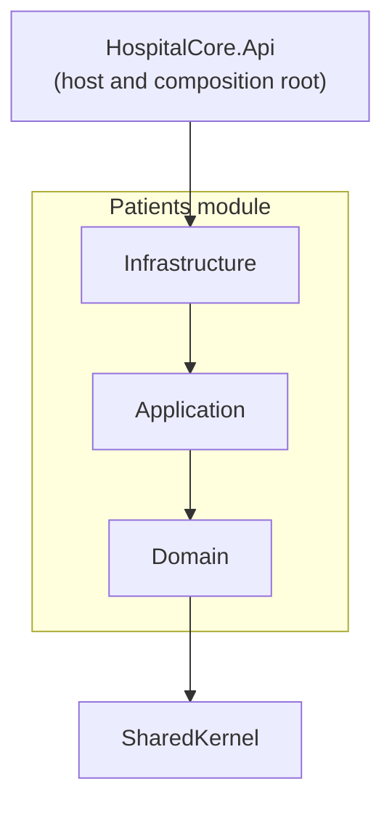

# HospitalCore

**Modern Hospital Information System built with .NET 10.**

HospitalCore is a portfolio project that explores how a hospital information system can be designed with modern .NET engineering practices: a modular monolith, Clean Architecture, Domain-Driven Design and automated quality gates.

> **Status:** early scaffolding. The solution structure, quality gates and documentation are in place; no business features have been implemented yet.

## Table of contents

- [Goals](#goals)
- [Technology stack](#technology-stack)
- [Architecture](#architecture)
- [Modules](#modules)
- [Solution structure](#solution-structure)
- [Getting started](#getting-started)
- [Quality gates](#quality-gates)
- [Documentation](#documentation)
- [Disclaimer](#disclaimer)

## Goals

- Model realistic hospital workflows (patients, appointments, admissions, laboratory, clinical records, billing) with original business rules.
- Keep module boundaries explicit and enforced by automated tests.
- Apply CQRS and DDD tactical patterns where they provide real value, not by default.
- Treat documentation, testing and architecture decisions as first-class deliverables.

## Technology stack

| Area | In use | Planned |
| --- | --- | --- |
| Language and runtime | C# 14, .NET 10 (LTS) | |
| API | ASP.NET Core Web API (controllers), OpenAPI document, Swagger UI, health checks, ProblemDetails | Authentication and authorization |
| Persistence | | Entity Framework Core 10, SQL Server 2025 |
| Caching | | Redis |
| Testing | xUnit v3 on Microsoft.Testing.Platform, `WebApplicationFactory` integration tests, NetArchTest architecture tests | Domain and application handler tests, database integration tests |
| Tooling | Central Package Management, analyzers with warnings as errors, `dotnet format` | |
| Delivery | | Docker, Docker Compose, GitHub Actions, Azure |

## Architecture

HospitalCore is a **modular monolith**: a single deployable application composed of business modules with explicit boundaries. Inside each module, code follows **Clean Architecture**, so dependencies always point towards the domain.



See [docs/architecture/overview.md](docs/architecture/overview.md) for the full picture and [docs/adr](docs/adr/README.md) for the reasoning behind each decision.

## Modules

| Module | Responsibility | Status |
| --- | --- | --- |
| Patients | Patient registration, demographics and identification | Scaffolded |
| Appointments | Outpatient scheduling | Planned |
| Admissions | Inpatient admissions, transfers, discharges and bed management | Planned |
| Laboratory | Lab orders and results | Planned |
| Clinical Records | Clinical notes and episode history | Planned |
| Billing | Charges and invoicing | Planned |
| Administration | Users, catalogues and configuration | Planned |

Modules are created when their first feature is implemented, not before.

## Solution structure

```text
HospitalCore/
├── docs/
│   ├── adr/                         Architecture Decision Records
│   └── architecture/                Architecture overview and diagrams
├── src/
│   ├── Api/
│   │   └── HospitalCore.Api/        ASP.NET Core host (controllers, middleware, composition root)
│   ├── BuildingBlocks/
│   │   └── HospitalCore.SharedKernel/
│   └── Modules/
│       └── Patients/
│           ├── HospitalCore.Modules.Patients.Domain/
│           ├── HospitalCore.Modules.Patients.Application/
│           └── HospitalCore.Modules.Patients.Infrastructure/
├── tests/
│   ├── HospitalCore.Api.IntegrationTests/
│   └── HospitalCore.ArchitectureTests/
├── Directory.Build.props            Shared build settings for every project
├── Directory.Packages.props         Central NuGet package versions
├── global.json                      Pins the .NET 10 SDK and the test platform
└── HospitalCore.slnx
```

## Getting started

### Prerequisites

- [.NET SDK 10.0.404](https://dotnet.microsoft.com/download/dotnet/10.0) or a later 10.0 feature band. `global.json` pins the SDK, so a machine with .NET 11 installed still builds with .NET 10.
- Git.
- Optional: Visual Studio 2026, JetBrains Rider or Visual Studio Code with C# Dev Kit.

SQL Server, Redis and Docker are not required yet.

### Build, test and run

```bash
git clone https://github.com/xXAPJXx/HospitalCore.git
cd HospitalCore

dotnet build
dotnet test
dotnet run --project src/Api/HospitalCore.Api
```

With the default `http` launch profile the API listens on `http://localhost:5187`:

| Endpoint | Description |
| --- | --- |
| `GET /health` | Liveness check, returns `Healthy` |
| `GET /openapi/v1.json` | OpenAPI document (Development only) |
| `/swagger` | Swagger UI (Development only) |

To use the `https` profile, trust the ASP.NET Core development certificate once with `dotnet dev-certs https --trust`.

## Quality gates

Every change is expected to pass:

- `dotnet build` with **warnings treated as errors** and the `latest-recommended` .NET analyzers.
- `dotnet test`, including architecture tests that fail when a layer or module boundary is broken.
- `dotnet format --verify-no-changes`, driven by `.editorconfig`.

## Documentation

- [Architecture overview](docs/architecture/overview.md)
- [Architecture Decision Records](docs/adr/README.md)
- [Changelog](CHANGELOG.md)

## Disclaimer

HospitalCore is an original work created for learning and portfolio purposes. It is inspired by general hospital management requirements and does not contain proprietary source code, database schemas, documentation or confidential information from any vendor or healthcare organisation. All data used in development and tests is synthetic.

HospitalCore is not a certified medical device and must not be used to manage real patient data.
