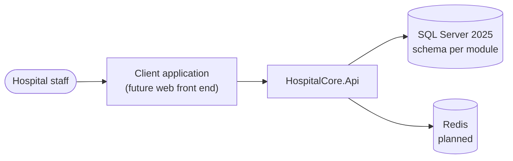
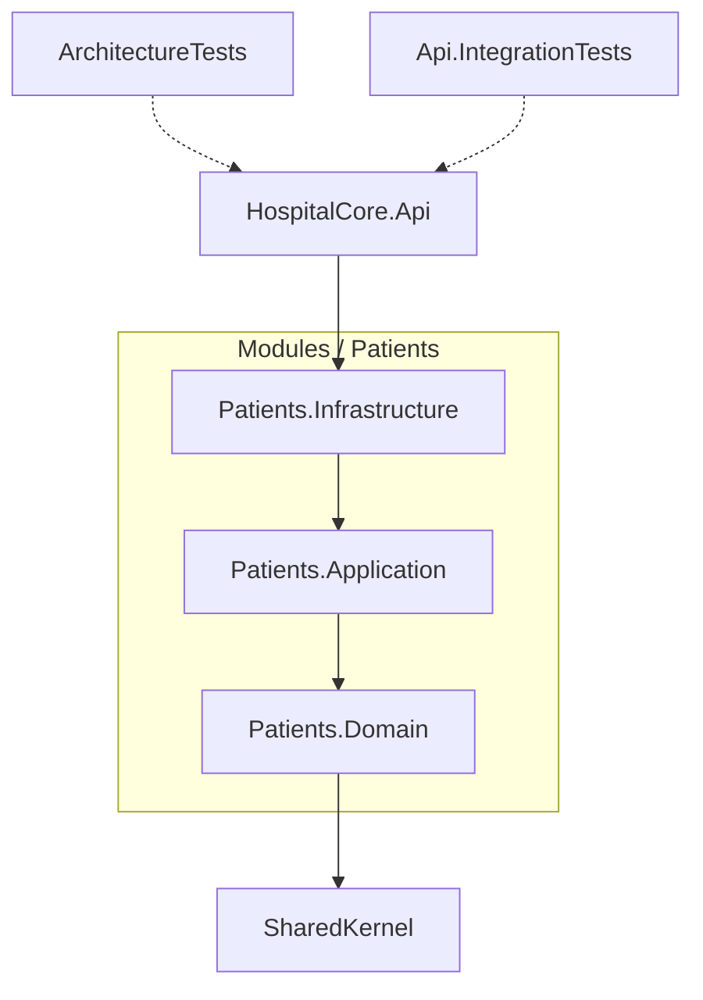
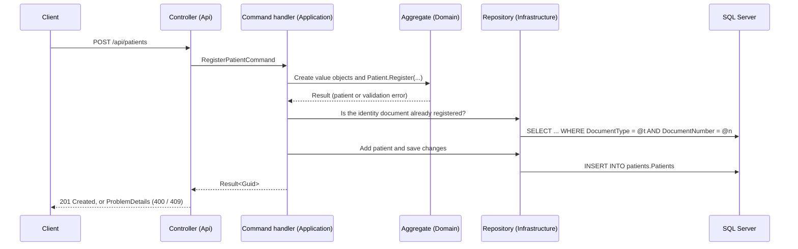

# Architecture overview

This document describes the current and target architecture of HospitalCore. Decisions and their trade-offs are recorded in the [Architecture Decision Records](../adr/README.md).

## Architectural style

HospitalCore is a **modular monolith** ([ADR-001](../adr/ADR-001-modular-monolith.md)):

- One deployable application, `HospitalCore.Api`, hosts every module.
- Each business capability lives in its own module under `src/Modules/<Module>`.
- Modules do not reference each other's internals. Cross-module communication will go through explicit contracts, defined in a future ADR when the second module is introduced.
- Each module will own its data through a dedicated database schema.

Inside each module the code follows **Clean Architecture** ([ADR-002](../adr/ADR-002-clean-architecture.md)).

## System context

## Project dependencies

Arrows point from a project to the project it depends on.

| Layer | Responsibility | May depend on |
| --- | --- | --- |
| Domain | Entities, value objects, domain events and business invariants | SharedKernel only |
| Application | Use cases (commands and queries), DTOs, ports implemented by Infrastructure | Domain |
| Infrastructure | Persistence with EF Core, external services, module registration | Application, Domain |
| Api | HTTP endpoints, middleware, configuration, dependency injection composition | Module Infrastructure and Application |

These rules are enforced by `tests/HospitalCore.ArchitectureTests`.

## Request flow

This is how `POST /api/patients` works today. Query handlers follow the same path without the domain operation and the save.

## Cross-cutting concerns

| Concern | Current state |
| --- | --- |
| Error handling | Expected failures travel as `Result` values with stable error codes and are mapped to RFC 9457 ProblemDetails (`400`, `404`, `409`) with a `code` extension. Unexpected exceptions are handled by `UseExceptionHandler` |
| Persistence | EF Core 10 with one `DbContext` and one SQL Server schema per module; migrations applied explicitly with `dotnet ef` |
| Time | `TimeProvider` is injected so date rules are deterministic in tests |
| Health | `GET /health` liveness endpoint |
| API documentation | Built-in OpenAPI document generation with Swagger UI in Development |
| Logging | Default ASP.NET Core logging; structured logging provider to be decided |
| Security | Not implemented yet; see future ADR-006 |
